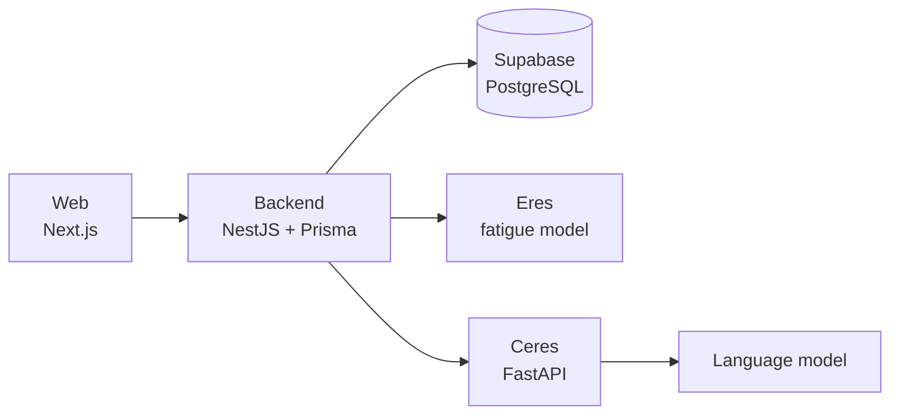
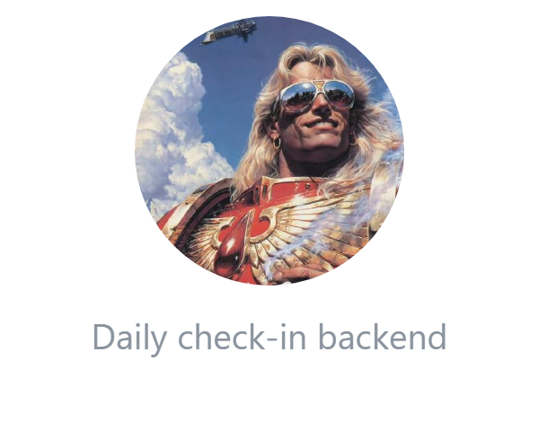
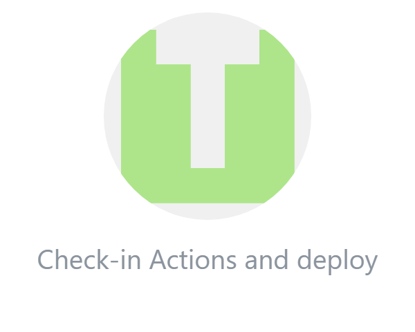
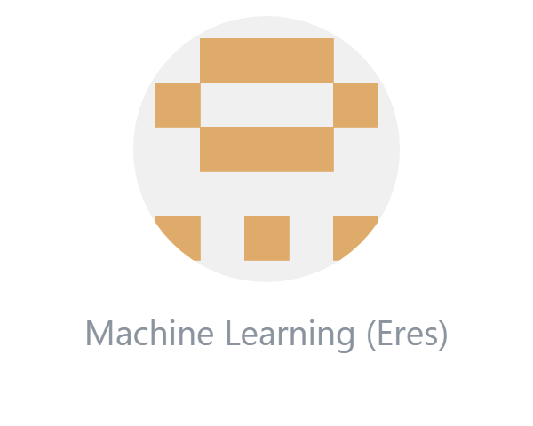
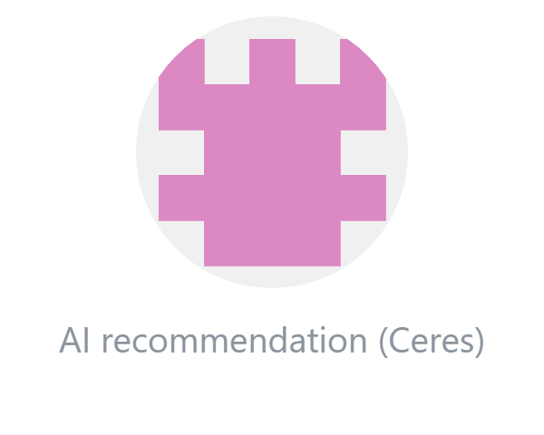

<div align="center">


# Mittus

### Health monitoring for astronauts on long-duration space missions

Daily check-ins · fatigue forecast · AI recommendations · mission context

[](https://www.spaceappschallenge.org/2026/challenges/health-monitoring-software/?tab=details)
[](https://www.spaceappschallenge.org/2026/local-events/campinas/)


</div>

---

## About

Mittus is our entry for the **NASA Space Apps Challenge 2026**, challenge **Create Health Monitoring Software for Astronauts on Space Missions**. It is a web app, in English, where an astronaut logs daily health indicators, follows fatigue trends, sees the mission context and gets an AI-written recommendation with a checklist of next steps.

> [!NOTE]
> The demo uses a fictional astronaut and **simulated health data**. The fatigue forecast is experimental and was trained on synthetic data. Nothing here is medical advice.

We take part on-line through the **Campinas, SP** local event, on 14 and 15 November 2026.

### Why sleep and fatigue

NASA's Human Research Program lists isolation and confinement, distance from Earth and a closed environment among the hazards of spaceflight, and links inadequate sleep and irregular schedules to risks for performance and health. Mittus therefore tracks sleep hours and self-reported fatigue, plus mood, stress and team conflict. Source: [NASA — Risk from Inadequate Sleep and Irregular Schedules](https://www.nasa.gov/reference/risk-from-inadequate-sleep-and-irregular-schedules/).

## Features

| | Feature | What the astronaut does |
| --- | --- | --- |
| 📝 | **Daily check-in** | Rates stress, mood, team conflict and fatigue, enters sleep hours (including custom hours) and adds an optional description. |
| 🧍 | **Home, 3D body and history** | Opens the sleep and fatigue panel from an interactive body point and reads charts of recent check-ins. |
| 📈 | **Fatigue forecast (Eres)** | Sees the chance of reporting high fatigue at the next check-in, with clear insufficient-history and unavailable states. |
| 🤖 | **AI recommendation and checklist (Ceres)** | Reads an insight card, **Make sense of the changes**, and up to two generated tasks in **My plan**. |
| ✅ | **Check-in Actions** | Marks tasks with **Got it**, **Mark complete** or **Dismiss**. |
| 🛰️ | **Mission context** | Sees departure, current position, destination and cabin temperature per mission phase, with the data source labeled (live, snapshot, TLE or simulated). |
| 🚀 | **Mission registration** | Fills in a mission and its outbound and return legs (the save route is still pending). |

Routes, tables and owners per feature are in [FEATURES.md](FEATURES.md).

## How it fits together



After a check-in is saved, the backend runs the Eres forecast and sends the check-in history and the forecast to [Ceres](https://github.com/mittus-health/ceres). Ceres returns the insight card and the tasks, and the backend stores them in `check_in_insights` and `check_in_actions`. A check-in never depends on Ceres: if it is unavailable, the check-in is still saved.

## Repository layout

| Path | What it is |
| --- | --- |
| [`backend/`](backend) | NestJS API with Prisma and PostgreSQL/Supabase: daily check-ins and Check-in Actions, with signed-cookie sessions. See its [README](backend/README.md). |
| [`web/`](web) | Next.js app: Home, 3D body, history and the `/api/mission-context` route (ISS position, cabin temperature samples). |
| [`ml/`](ml) | Eres, the experimental fatigue model (`@mittus/fatigue-model`). `train.py` trains on synthetic sessions and `index.js` exposes `predictFatigue`. |
| [`db/`](db) | Reproducible seed of simulated check-ins and actions. See its [README](db/README.md). |
| [`supabase/migrations/`](supabase/migrations) | Canonical SQL history of the schema. |
| [`docs/`](docs) | Check-ins spec, database notes and the [MVP plan](docs/superpowers/plans/2026-11-14-mittus-mvp.md). |

## Getting started

**Requirements:** Node.js 24 and pnpm 10 for the backend, Node.js and npm for the web app and the seed, and Python only to retrain Eres (`ml/requirements.txt`).

<details>
<summary><b>Backend</b></summary>

```bash
cd backend
pnpm install
pnpm prisma:generate
pnpm start:dev
```

Copy `.env.example` to `.env` and set `DATABASE_URL`, `SESSION_SECRET` (at least 32 random characters) and `WEB_ORIGIN`. Starting the API does not apply migrations, and the shared database must not be reset or pushed to. The full endpoint list is in the [backend README](backend/README.md).

</details>

<details>
<summary><b>Web</b></summary>

```bash
cd web
npm install
npm run dev
```

</details>

<details>
<summary><b>Tests</b></summary>

```bash
cd backend && pnpm test          # unit tests
cd backend && pnpm test:e2e      # end-to-end, needs a database
cd web && npm test
```

</details>

## Data and external sources

| Data | Source |
| --- | --- |
| Health data | Simulated by the team ([`db/`](db)). The Eres model is trained on synthetic sessions. |
| ISS position | [Where the ISS at?](https://wheretheiss.at/w/developer) API |
| Free-flight position | Orbital elements from [CelesTrak](https://celestrak.org/NORAD/documentation/gp-data-formats.php), propagated with SGP4 (`satellite.js`) |
| Launch data | [Launch Library 2](https://ll.thespacedevs.com/docs/) (The Space Devs), copied once when a mission is registered |
| Cabin temperature | Historical sample from the [NASA Environmental Data App](https://visualization.osdr.nasa.gov/eda/) |
| Language model | Used by Ceres to write the insight and task titles. It never decides which tasks exist. |

## Documentation

- [FEATURES.md](FEATURES.md) — features, routes, database and owners
- [Check-ins spec](docs/specs/check-ins-spec.md) and [database notes](docs/check-ins-database.md)
- [Missions database](docs/missions-database.md) and [mission context backend](docs/mission-context-backend.md)
- [MVP plan](docs/superpowers/plans/2026-11-14-mittus-mvp.md)
- [Submission requirements](REQUISITOS-DE-ENTREGA.md)
- [Challenge statement](https://www.spaceappschallenge.org/2026/challenges/health-monitoring-software/?tab=details)

## Team

<p align="center">
  <a href="https://github.com/luismede"></a>
  <a href="https://github.com/Neveslv"></a>
  <a href="https://github.com/luibiondo"></a>
  <a href="https://github.com/RodrigoBolgheroni"></a>
  <a href="https://github.com/giumanara"></a>
  <a href="https://github.com/gabkbenfica"></a>
</p>
